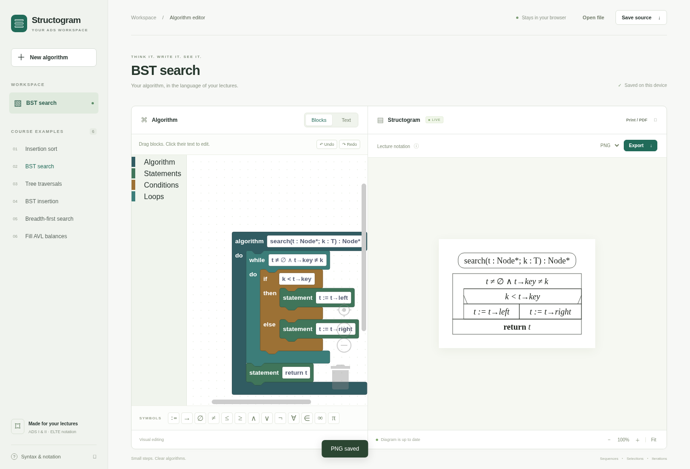

# Structogram ADS

A browser editor for the structure diagrams used in the ELTE Algorithms and Data Structures lectures. Edit one algorithm in two linked modes:

- **Blocks:** drag Statement, If, While, For, and Selection blocks into an Algorithm block. Write operators and conditions directly in their fields. Nest blocks by connecting them inside a body or branch.
- **Text:** write indented pseudocode. Switching to Blocks preserves the algorithm; changing a visual block updates both the text and the lecture-style diagram.

The diagram follows the uploaded course PDFs: rounded routine signatures, loop rails, thin monochrome borders, diagonal selection marks, and `SKIP` for an empty branch. Pseudocode is treated as text and structure; it is never executed.



## Open the editor

After this change is merged and GitHub Pages deployment succeeds, open:
**https://23sdd.github.io/StructogramProgForADS/**

No ZIP, shell script, Electron, administrator access, or macOS security exception is needed. In repository **Settings → Pages**, select **GitHub Actions** as the source if it is not already selected. The Pages workflow tests pull requests and publishes only accepted changes on `main`.

For an app window and icon, use **Safari → File → Add to Dock** on macOS Sonoma or later. Chrome/Edge offer **Install app** in their menu/address bar. On iOS use Safari → Share → Add to Home Screen. The editor's **Use as an app** button provides these instructions or the browser's installation prompt where supported.

Open the editor online once and wait for **Ready offline**. After adding it to the Dock/home screen, open that app once online too: some browsers use separate app storage. It can then reopen and edit/export without a connection. Offline storage may be unavailable in private browsing or removed by the browser when storage is cleared/evicted. Use **Save source** to keep backups outside the browser.

To transfer a document from the previous desktop app, save its `.ads` source there, then select **Open file** here. Existing desktop data is not automatically accessible to a website. Clearing browser data removes local documents and offline files; it does not delete downloaded `.ads` backups.

New versions download in the background when online. Existing tabs keep their version to avoid disrupting edits. When “Update ready” appears, save a backup, close all editor tabs/windows, then reopen. Browser-local storage is preserved during app updates.

## Use the two editing modes

**Blocks** opens by default. Select a category on the left, drag out a block, and click a text field to edit it. The Algorithm block holds the routine signature and body. Statement blocks accept assignments, declarations, procedure calls, `return`, comments, and `SKIP`. If blocks have editable conditions plus then/else bodies. While and For blocks have editable conditions or iteration ranges.

Selections accept connected Case blocks. Add at least two, write their guards, and use `otherwise` for an optional final default branch. Case blocks connect only inside a Selection; ordinary statements connect inside routine, branch, or loop bodies. Empty bodies generate `SKIP` automatically. Loose blocks must be connected or removed before exporting or switching to Text, so statements are not silently dropped.

The **Text** tab exposes the same pseudocode. It supports Tab/Shift+Tab, automatic indentation, mathematical symbols, and multiple routines. Fix malformed text before returning to Blocks; the editor keeps the text and error visible. Changing modes alone does not rewrite your original formatting. A subsequent block edit generates consistently indented text and explicit `SKIP` branches.

Use the visual Undo/Redo buttons. Click a diagram row to find its matching block or text line. Save `.ads` source files with **Save source** or **⌘S / Ctrl+S**, open them with **Open file**, and print or save PDF with **Print / PDF**. SVG and PNG exports use the same renderer as the preview.

The current document, selected mode, and visual layout are saved locally. Separate `.ads` files contain editable pseudocode; reopening them reconstructs their blocks. No accounts, analytics, external fonts, CDN, or server-side document processing are used. Online requests fetch application assets and check for application updates; algorithm contents are not uploaded. Hosting providers still receive ordinary requests for site assets.

## Source notation

```text
search(t : Node*; k : T) : Node*
  while t ≠ ∅ ∧ t→key ≠ k
    if k < t→key
      t := t→left
    else
      t := t→right
  return t
```

Use consistent indentation within each block (two spaces recommended). No closing `end` keywords are needed. Empty bodies require `SKIP` in Text mode; an omitted `else` becomes an implicit `SKIP`. Conditions are not evaluated and the algorithm's mathematical correctness is not checked.

The preview converts `->`, `!=`, `<>`, `<=`, `>=`, `&&`, `||`, `!`, and `NULL`/`null` into the course's mathematical symbols. It preserves `:=` for assignment and `=` for equality. Source files retain the text as typed until a visual edit regenerates the document. Comments beginning with `//` remain literal text.

Malformed input pauses the preview, dims the previous diagram, and disables export/printing. Limits are 100,000 source characters, 1,500 non-empty lines, 24 nested levels, and 12 branches in a selection.

## Open-source components and project licensing

Blockly is Apache-2.0 and is bundled locally with its license. Node.js is used only to develop/build the site and is not installed on visitors' computers.

**No license has been added to this project's own code**, as requested by the owner. See [THIRD_PARTY_NOTICES.md](THIRD_PARTY_NOTICES.md).

## Security boundaries

The app runs inside the browser sandbox, without a native bridge or shell installer. It reads files you select and saves through browser downloads/print. Pseudocode never becomes executable JavaScript. Rendered text is XML-escaped, and parser size/depth limits protect against unreasonable input. The page's Content Security Policy forbids inline/evaluated scripts, external scripts, frames, plugins, and form submission. Inline **styles** are allowed because Blockly positions its controls dynamically. Connections are limited to the same origin for application assets and offline caching.

These measures reduce risk; they do not constitute an independent security audit. Updates still depend on the repository and hosting account remaining trustworthy. Review changes before merging and protect the GitHub account with two-factor authentication. No documents are placed in the service-worker cache; they remain in browser-local workspace storage or downloaded files.

## Development and checks

Developers need Node.js 22 or later:

```sh
npm ci
npm run build
npm test
npm start
```

`npm start` serves `dist/` at localhost:4173. Edit modules in `src/`, rebuild, and commit the generated `app.bundle.js`. All deployed dependencies are local. `scripts/build.mjs` generates a content-versioned service worker that precaches the complete app. It uses relative paths for GitHub project Pages and keeps old tabs on a consistent version until closed.

Tests cover Blockly round trips, field editing, nested branches, malformed text, escaped SVG, and offline cache isolation/lifecycle. Browser QA covers actual editing, downloads, CSP, and an offline reload. GitHub Actions runs the automated tests before publishing the built `dist/` on pushes to `main`. PR builds do not publish or run a Mac installer.

## Course references

The uploaded documents are notation references, not application instructions. Original PDFs and exam materials are not redistributed:

- Tibor Ásványi, *Algorithms and Data Structures I — Lecture Notes*, April 21, 2026: notation pp. 4–5; insertion sort p. 20; BST diagrams p. 54.
- *Algorithms and Data Structures II — Graphs*, October 1, 2026: BFS p. 15, with optional colour annotations omitted in the example.
- *Algorithms and Data Structures II — Trees*, October 8, 2025: AVL balance convention.
- *Algorithms and Data Structures II — Test 1 (example exercises)*, October 8, 2026: AVL-7 motivates the fill-balances worked solution; it is not an official supplied solution.

This is an independent learning tool. Its geometry follows the lecture diagrams, with approximate typography and spacing.

## Files

| File | Purpose |
| --- | --- |
| `src/blocks.js`, `src/block-model.js` | Visual editor and linked text conversion |
| `src/parser.js`, `src/renderer.js` | Course parser and SVG diagrams |
| `src/app.js` | Editing, browser persistence, imports and exports |
| `pwa.js`, `manifest.webmanifest` | Offline status and app installation guidance |
| `scripts/service-worker-template.js` | Scoped, versioned offline cache |
| `.github/workflows/pages.yml` | Tests and GitHub Pages publication |
